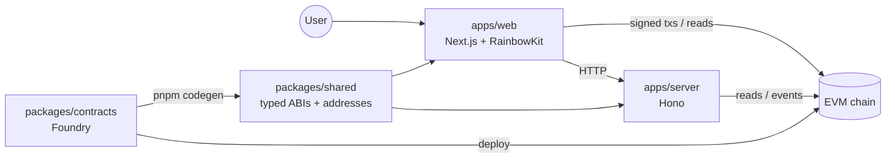

# Project name

> One-line pitch.

## Problem

<!-- Who has the problem, and why it matters. -->

## How it works

<!-- The user flow in 3–5 steps. -->

## Architecture

<!-- Update this diagram as the product grows. Template details: docs/ARCHITECTURE.md -->



## Deployed addresses

| Network | Contract | Address | Explorer |
| ------- | -------- | ------- | -------- |
|         |          |         |          |

## Demo video

<!-- Link -->

## Why onchain

<!-- What a normal database can't give you here. -->

## Limitations

<!-- Known gaps, shortcuts taken during the hackathon, what you'd do next. -->

## Built with / starter template disclosure

<!-- List what the team built during the event vs. what came from this template. -->

This project started from **eth-starter**, a minimal EVM hackathon template (plumbing, testing and
demo tooling only, no product logic): pnpm monorepo, Foundry + OpenZeppelin, wagmi CLI codegen,
Next.js + wagmi + viem + RainbowKit + Tailwind, Hono. The example `SimpleEscrow` contract and UI
came with the template.

---

# Developing

## Prerequisites

- **Node 20.20.2**: `nvm use` (reads `.nvmrc`). Node ≥ 20.19 is required.
- **pnpm 10.15.0**: `corepack enable` (version comes from `packageManager` in `package.json`).
- **Foundry v1.8.7** ([install docs](https://getfoundry.sh/introduction/installation)):
  ```sh
  curl -L https://foundry.paradigm.xyz | bash
  foundryup --install v1.8.7
  ```

## Quickstart

```sh
pnpm install
pnpm dev
```

`pnpm dev` starts a local chain (anvil), deploys the contracts, generates typed ABIs, then runs
the server (http://localhost:8787) and web app (http://localhost:3000). No keys or accounts are
needed.

To click through the app, your browser wallet needs local ETH. Import one of anvil's dev
accounts (keys are printed in `.anvil/anvil.log`; they are public, use them only locally), or
send yourself some from dev account #0:

```sh
cast send <your-address> --value 10ether --rpc-url http://127.0.0.1:8545 \
  --private-key $(cast wallet private-key "test test test test test test test test test test test junk")
```

Each `pnpm dev` starts a fresh chain, so clear your wallet's cached activity for the local
network after a restart (otherwise transactions can hang on a stale nonce).

## Commands

| Command                       | What it does                                                                                   |
| ----------------------------- | ---------------------------------------------------------------------------------------------- |
| `pnpm dev`                    | anvil + deploy + codegen + server + web, all local                                             |
| `pnpm dev:testnet`            | server + web only, using each app's `.env` (e.g. pointed at Sepolia)                           |
| `pnpm test`                   | Foundry tests (unit, fuzz, invariant, fork if `FORK_RPC_URL`) + shared tests                   |
| `pnpm e2e:happy`              | Full path through contract and server, exactly as the UI does it. Run this before touching UI. |
| `pnpm codegen`                | Rebuild contracts, regenerate `packages/shared/src/generated.ts`                               |
| `pnpm deploy:local`           | Redeploy to a running anvil, then codegen                                                      |
| `pnpm deploy:sepolia`         | Deploy to Sepolia with your Foundry keystore, then codegen                                     |
| `pnpm typecheck`              | TypeScript across all packages                                                                 |
| `pnpm lint` / `pnpm lint:fix` | ESLint (style rules are warnings)                                                              |
| `pnpm format`                 | Prettier                                                                                       |

## Environment

Nothing is required for local development. Each `.env.example` is commented with doc links.

| File                              | Used by                    | Fill in for testnet                                                                            |
| --------------------------------- | -------------------------- | ---------------------------------------------------------------------------------------------- |
| `.env.example`                    | `pnpm e2e:happy`           | `CHAIN_ID`, `RPC_URL`, `E2E_PRIVATE_KEY` (throwaway)                                           |
| `apps/web/.env.example`           | web (copy to `.env.local`) | `NEXT_PUBLIC_CHAIN_ID`, `NEXT_PUBLIC_RPC_URL`, optional `NEXT_PUBLIC_WALLETCONNECT_PROJECT_ID` |
| `apps/server/.env.example`        | server (copy to `.env`)    | `CHAIN_ID`, `RPC_URL`                                                                          |
| `packages/contracts/.env.example` | deploy, verify, fork tests | `SEPOLIA_RPC_URL`, `ETHERSCAN_API_KEY` (only for Etherscan)                                    |

The WalletConnect project ID is optional. Without it the app offers browser wallets only and
logs a note in the console.

## Layout

```
apps/
  web/            Next.js app. app/app.tsx is the page; components/ holds its parts
  server/         Hono API: /health, /api/feed (escrow events)
packages/
  contracts/      Foundry: SimpleEscrow example, tests, deploy script (see its README)
  shared/         chain configs + generated ABIs/addresses (pnpm codegen)
scripts/          dev orchestrator, e2e:happy
docs/             ARCHITECTURE.md, DEMO_SCRIPT.md
VERIFIED.md       every external value, its source and check date
```

## Going to Sepolia

1. Deploy and verify: `packages/contracts/README.md`.
2. `apps/web/.env.local`: `NEXT_PUBLIC_CHAIN_ID=11155111` (+ `NEXT_PUBLIC_RPC_URL`).
   `apps/server/.env`: `CHAIN_ID=11155111` (+ `RPC_URL`).
3. `pnpm dev:testnet`, then `pnpm e2e:happy` with the root `.env` set for Sepolia.

To add another chain, see `packages/shared/src/chains.ts` (a few lines; metadata comes from
`viem/chains`).

## Making it yours

- Replace `SimpleEscrow` (contract, tests, the `Deploy.s.sol` lines) and the escrow components
  in `apps/web/src/components/`.
- Keep `lib/use-tx.ts` + `components/tx-status.tsx` for every write, and `connect-button.tsx`.
- Restyle via the tokens in `apps/web/src/app/globals.css`.

## CI

GitHub Actions (`.github/workflows/ci.yml`): `contracts` (forge tests + generated ABIs up to
date) and `typecheck` should be marked as required checks in branch protection; `lint` is
informational and never blocks.

## License

MIT
